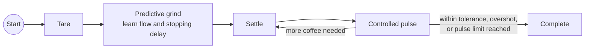

# Smart Grind-by-Weight · Eureka V2 fork

Grind-by-weight for the Eureka Mignon using a Waveshare ESP32-S3 1.64" AMOLED
board and a load cell. This fork builds on the
[community project by Clinteastman](https://github.com/Clinteastman/smart-grind-by-weight)
(itself continuing [jaapp's original](https://github.com/jaapp/smart-grind-by-weight))
and focuses on the **newer V2 board (SH8601 display)**, smoother display
performance and reliable Wi-Fi updates.

**[Flash firmware](https://marvin-rse.github.io/smart-grind-by-weight/)** ·
**[Download releases](https://github.com/marvin-rse/smart-grind-by-weight/releases)** ·
**[V2 wiring & setup](docs/MY_SETUP.md)** ·
**[Changelog](CHANGELOG.md)** ·
**[Troubleshooting](docs/TROUBLESHOOTING.md)**

## What's different in this fork

Current version: **[v1.6.3](https://github.com/marvin-rse/smart-grind-by-weight/releases/latest)**.
Compared with the upstream community firmware:

**Display (V2)**
- No green flash at power-on — the backlight stays off until the first frame is drawn.
- Smoother display — frames are rendered once into PSRAM instead of in many small strips.
- No stutter when swiping between Single, Double and Custom — the selected dose
  is saved after the animation, not during it.

**Firmware updates**
- Updates are offered from this fork, so installing one keeps these changes.
- Reliable while Bluetooth is active — the grinder restarts once without
  Bluetooth and continues the update automatically.
- GitHub downloads resume after a dropped connection instead of failing.
- Manual uploads show each step and real progress, and confirm the new build
  after the restart.
- Manual uploads refuse firmware for the wrong board generation.

**Web interface**
- Served compressed (16 KB instead of 56 KB) and cached by the browser.
- Optional **Wi-Fi power saving** switch (Settings → Connectivity) for a faster interface.
- Wi-Fi signal strength on the system page.

**Grind history and diagnostics**
- Delete a single grind (e.g. a test run); it is also removed from the lifetime statistics.
- Keeps the latest 50 grinds instead of 10.
- The diagnostic log survives restarts, so the reason for a failed update is never lost.

Every change is covered by host tests in [`tools/tests`](tools/tests) and built
for both board generations by CI.

## Which firmware file do I need?

Identify the board **by its display, not by the `Rev1.1` print on the PCB**
(see [Display stays black after flashing](docs/TROUBLESHOOTING.md#display-stays-black-after-flashing-waveshare-164-v2)).

| Your board | First install (USB, web flasher) | Update over Wi-Fi (*System & updates → Manual firmware file*) |
| --- | --- | --- |
| **V2** – SH8601 display (newer) | select **V2** in the [web flasher](https://marvin-rse.github.io/smart-grind-by-weight/) | `smart-grind-by-weight-vX.Y.Z-waveshare-164-v2.bin` |
| **V1** – CO5300 display (original) | select **V1** in the [web flasher](https://marvin-rse.github.io/smart-grind-by-weight/) | `smart-grind-by-weight-vX.Y.Z.bin` |

> [!IMPORTANT]
> Never upload files ending in `-web-ota`, `-bootloader` or `-partitions`, or
> the `.manifest.json` — they are used by the web flasher only. A V1 image on a
> V2 board leaves the display black, so the grinder refuses it.

**Updating:** on the grinder's web page open *System & updates* and press
*Install update*, or upload the matching file manually. Keep the page open
until it reports the new build.

## V2 wiring at a glance

The V2 board needs different GPIOs than the original guide:

| Signal | V1 (original guide) | **V2** |
| --- | --- | --- |
| HX711 SCK | GPIO 2 | **GPIO 1** |
| HX711 DOUT | GPIO 3 | GPIO 3 |
| Motor (Eureka plug pin 3) | GPIO 18 | **GPIO 16** |
| GPIO 18 | motor | **leave unconnected** (touch interrupt) |

Full wiring, load-cell colours and commissioning steps: [docs/MY_SETUP.md](docs/MY_SETUP.md).

<table>
<tr>
<td width="50%">

https://github.com/user-attachments/assets/e20ce3e2-417e-4a3b-bb48-05591fce9418

</td>
<td width="50%">

</td>
</tr>
</table>

## Features

Everything from the community project is included:

- **Accurate grind-by-weight control** with predictive motor stopping,
  controlled finishing pulses and a configurable tolerance of ±0.03 g.
- **Three editable profiles** (Single, Double, Custom), synchronized between
  touchscreen and browser, plus **grind-by-time** and a target-free
  **Manual mode** with a 30-second safety cutoff.
- **Responsive AMOLED interface** with chart and arc views and swipe gestures.
- **Motor-latency tuning** (automatic or manual) and adjustable coast compensation.
- **Automatic start** when a cup or portafilter is placed (configurable threshold).
- **Screensavers**, custom image upload and an optional GaggiMate status view.
- **Local Wi-Fi web app** at `http://smartgrind.local` with live weight and
  flow, dose selection, start/stop, settings, grind history with charts and
  CSV/JSON downloads, and firmware updates.
- **Wi-Fi setup on the device** with network scan, captive portal and QR code.
- **Home Assistant** via the companion
  [Smart Grind integration](https://github.com/Clinteastman/smart-grind-home-assistant).

<table>
<tr>
<td width="50%"><strong>Live dashboard</strong> </td>
<td width="50%"><strong>Grind history</strong> </td>
</tr>
</table>

## Building one

> [!CAUTION]
> This is an experimental mains-powered appliance modification. Disconnect the
> grinder from power before opening it, preserve protective earth and insulation,
> and ask a qualified person to handle mains wiring if you are not competent to
> do so. Build and use it at your own risk.

1. **Parts:** [parts list](docs/HARDWARE_INSTALLATION.md#parts-list) and
   [grinder compatibility](docs/GRINDER_COMPATIBILITY.md).
2. **3D prints:** STL files in [`3d_files`](3d_files) and
   [community designs](docs/3D_PRINTS.md).
3. **Identify V1 or V2** (see above), then **flash over USB** with the
   [web flasher](https://marvin-rse.github.io/smart-grind-by-weight/) before
   wiring — the display must show something.
4. **Wire and assemble** following [docs/MY_SETUP.md](docs/MY_SETUP.md) (V2) or
   the [original guide](docs/DOC.md#start-here) (V1), and the
   [Eureka build video](https://youtu.be/-kfKjiwJsGM).
5. **Calibrate:** *Menu → Calibrate*, then *Menu → Tune Pulses*.

The Eureka installation can be reversed without permanently modifying the grinder.

## How grinding works

The controller learns flow and motor latency during each grind, stops the motor
before the target and finishes with short, bounded pulses — no bean- or
grind-size profile needed.

## Development

PlatformIO targets, simulator and tests: [docs/DEVELOPMENT.md](docs/DEVELOPMENT.md).
Releases are built by GitHub Actions: pushing a branch `release/vX.Y.Z` builds
both board generations, publishes release `vX.Y.Z` and updates the web flasher.

When reporting a problem, include your board generation, the firmware build and
the diagnostic log (*System & updates → Recent diagnostic log → Download*).
Problems that also occur with the upstream firmware belong to the
[community project](https://github.com/Clinteastman/smart-grind-by-weight/issues).

## Credits and license

- Original project by [Jaap Pieroen (@jaapp)](https://github.com/jaapp); community
  maintenance and V2 support by [Clinteastman](https://github.com/Clinteastman)
  with contributions from [Randy1st](https://github.com/Randy1st),
  [Woutifier](https://github.com/Woutifier), [quickcoffee](https://github.com/quickcoffee)
  and [FleischerT](https://github.com/FleischerT). Their commit history is retained.
- Inspired by [openGBW](https://github.com/jb-xyz/openGBW) and
  [Coffee Grinder Smart Scale](https://besson.co/projects/coffee-grinder-smart-scale).

Free software under the [GNU General Public License v3.0 or later](LICENSE).
